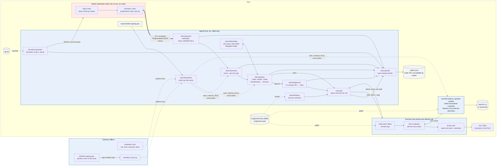
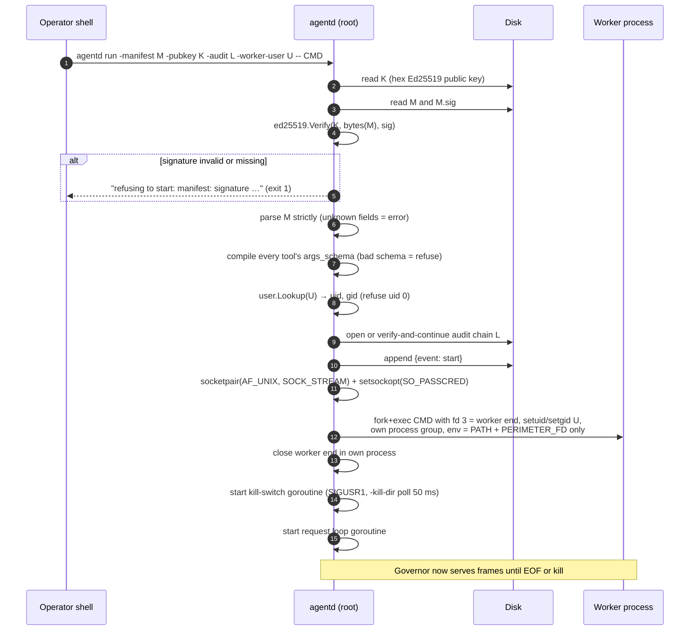
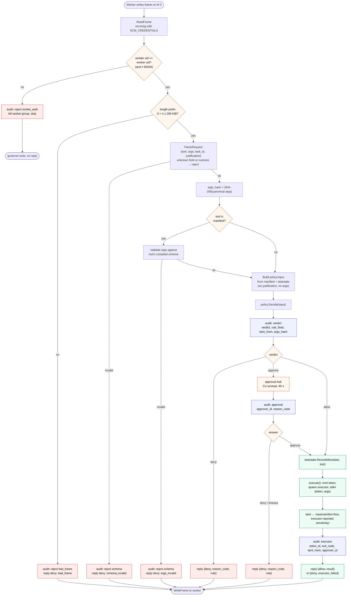
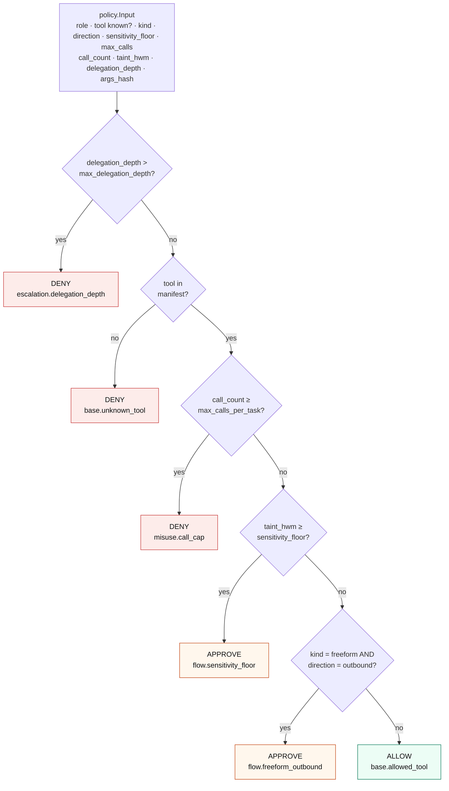
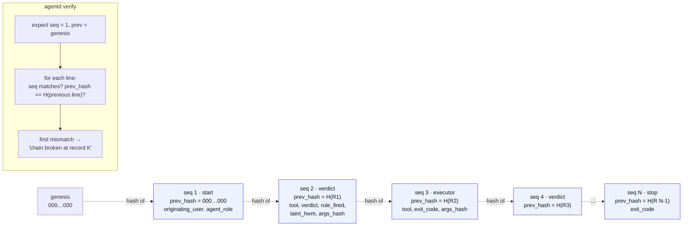
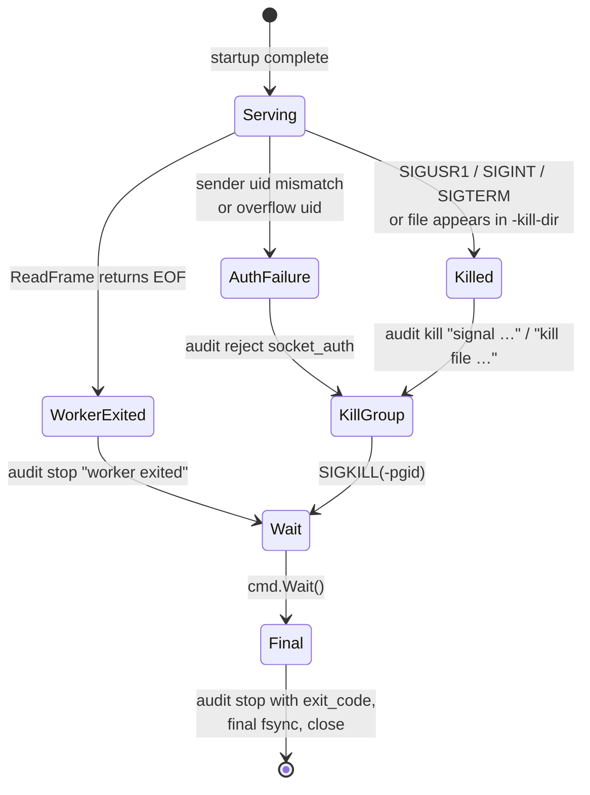
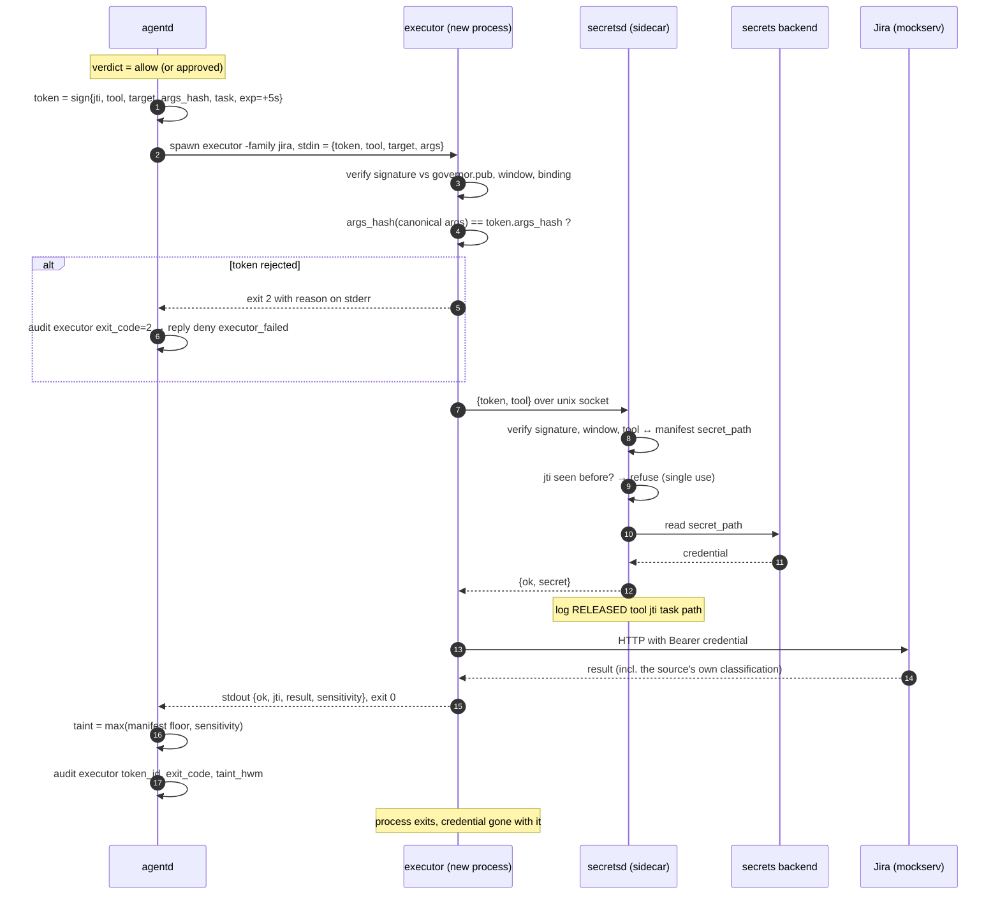

# Architecture, as built (through week 3)

Seven diagrams, each answering one question about how `agentd` works today. They describe the code in this repository at this commit, not the plan. Where a part is a stand-in for something later, the diagram says so.

1. [What the pieces are and where the trust boundary sits](#1-components-and-trust-boundary)
2. [What happens when `agentd` starts](#2-startup-sequence)
3. [What happens on every tool call](#3-request-flow)
4. [How a verdict is reached](#4-policy-decision)
5. [What the audit chain looks like and why edits are caught](#5-audit-chain)
6. [How the governor stops](#6-shutdown-and-kill-switch)
7. [How an allowed call gets its credential without the governor ever holding it](#7-execution-and-credential-path)

---

## 1. Components and trust boundary

The agent lives in an untrusted process. Its only way to affect the world is a single socket to the governor. Everything that decides, signs, or records lives on the governor's side of that line.

**Reading it.** Solid double arrow: the only channel the worker has. Dotted arrows: configuration the governor reads at startup. The worker has no network, no environment variables beyond `PATH`, no credentials, no view of the audit log, and no way to reach anything on the right side except by asking the governor over fd 3.

**Where secrets are.** Only two boxes ever hold a service credential: `secretsd`, which holds the backend credential for its lifetime, and one executor, which holds one secret for one call. The governor's only knowledge of secrets is the sidecar's socket path, which it passes to executors. See §7.

**Stand-ins today.** `mockserv` stands in for Jira and Slack. The worker still runs as a plain user rather than in a container, and executors share the host network; week 4 adds both.

---

## 2. Startup sequence

Nothing is spawned until the manifest proves it was signed by the operator's key. A signature failure is a refusal to start, not a warning.

**Why the order matters.** Verify before parse (step 4 before 5): the parser only ever sees bytes the operator signed. Compile schemas before spawn (7 before 11): a bad manifest fails at startup, never on the first request. Close the worker end (12): otherwise the governor would never see EOF when the worker dies.

---

## 3. Request flow

One frame in, one frame out. Every box on the left side is a check that can end the request before anything executes; the order is fixed and each rejection is recorded.

**Two things to notice.** The `justification` string enters at `ParseRequest` (length-checked) and then goes nowhere: it is not in `Input`, not in the hash, not in the audit record. And `args_hash` is computed once and threads through the verdict record, the executor record and, from week 3, the token — so the same canonical arguments produce the same hash everywhere, and a replay with different arguments is visible as a different hash.

**Approve.** The approval record is written whatever the human answers, with who answered and why it resolved (`approved`, `declined`, `approval_timeout`, `approval_unavailable`). An approved call then follows the allow path, and its executor record carries the approver's id.

**Dry-run.** With `-dry-run`, `deny` and `approve` still produce their audit record but fall through to `RecordAllow → execute`, and every record carries `dry_run: true`. That is how a policy is tuned against a real agent before it is enforced.

---

## 4. Policy decision

`Decide` is a fixed list of rules read top to bottom; the first that fires wins, and reading down they only ever get stricter. The input is built by the governor from the manifest and the task store. Nothing the agent wrote is in it.

**Where each number comes from.** `role`, `kind`, `direction`, `sensitivity_floor`, `max_calls_per_task`, `max_delegation_depth`: the signed manifest. `call_count`, `taint_hwm`, `delegation_depth`: `internal/taskstate`, which only the governor writes. `tool known?`: whether the manifest has a tool by the requested name. Two tests pin this down: `TestInputCarriesNoAgentText` fails the build if a text-shaped field is ever added to `Input`, and `TestDeterministic` shows identical inputs give identical decisions.

**As of week 2** the diagram above is realised in two layers. The first two diamonds (delegation depth, tool known) are Go pre-checks in `Engine.Decide`. Everything else is Cedar: `policies/base.cedar` holds the `forbid` rules (call cap, sensitivity floor, freeform outbound, delegation restated), `policies/<role>.cedar` holds one `permit` per tool with optional target constraints. The request is `principal = Agent::"<role>"`, `action = Action::"<tool>"`, `resource = Target::"<resource_arg value>"`, context = the facts listed in the input box. A `forbid` annotated `@verdict("approve")` yields APPROVE only if a permit would otherwise have matched; a plain `forbid` yields DENY; no matching permit yields DENY. Cedar's forbid-overrides-permit semantics give "only gets stricter" as a language guarantee rather than an ordering convention.

---

## 5. Audit chain

Every record carries the SHA-256 of the previous record's exact bytes. Edit, insert or delete one line and every link after it fails. `agentd verify` walks the chain and names the first bad record.

**What is in a record.** Three identities on every line (`originating_user`: who launched the governor; `agent_role`: from the manifest; `approver_id`: empty until week 3's approval gate). The event (`start`, `verdict`, `executor`, `reject`, `kill`, `stop`). For verdicts: the verdict, the rule that fired, the reason code, the taint mark at that moment, and the args hash — never the args themselves. For executor outcomes: exit code and, from week 3, the token id.

**Write path.** Each record is flushed to the OS immediately; `fsync` is batched at 50 ms so the chain does not cost a disk sync per tool call. On open, an existing chain is verified before it is extended; a broken chain is refused and left as evidence.

---

## 6. Shutdown and kill switch

Three ways the governor stops. The kill switch runs on its own goroutine, so a worker that floods the request loop cannot delay it.

**Why the process group.** The worker is started with `Setpgid`, so `SIGKILL` to the negative pid reaches the worker and everything it forked — a shell tool, a subprocess an agent framework spawned — in one call. **Why kill before wait on auth failure.** A worker that sent a bad frame may be blocked waiting for a reply that will never come; waiting on it first would deadlock the governor (found and fixed in week 1 testing).

---

## 7. Execution and credential path

An allowed call becomes a short-lived signed token and a fresh process. The governor signs; the executor and the sidecar each verify independently against the governor's public key; the secret travels sidecar → executor and nowhere else.

**What a captured token buys an attacker.** Nothing useful: it is bound to one tool, one target and one exact set of arguments (steps 4–5), it is refused by the sidecar the second time it is seen (step 8), and it expires in five seconds. The replay, swapped-args, wrong-tool and rogue-key cases are all in `itest.sh` and the test plan (M-10).

**What the governor never has.** A backend credential, a Vault token, or a secret. If the governor is compromised, it can authorise calls it should not; it cannot harvest credentials. That is the reason the sidecar is a separate, operator-started process rather than a library inside the governor.

## What is deliberately not here yet

| Piece | Week | Appears in diagram |
| --- | --- | --- |
| Worker container, executor netns, egress proxy | 4 | Hardens the worker box in §1; adds the proxy |
| Real agents, MCP bridge | 5 | Replaces `stub_worker.py` in §1 |
